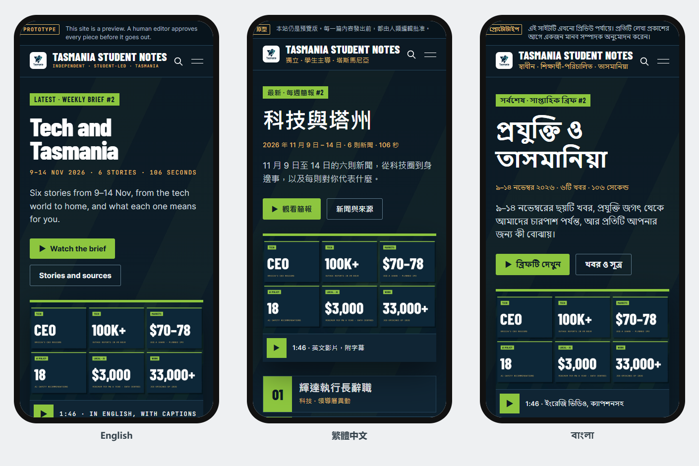
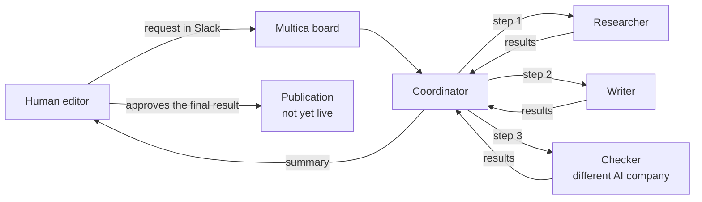

# Tasmania Student Notes

**English** · [简体中文](README.zh-CN.md)

> An independent, student-led publication for Tasmania, in six languages, with a
> newsroom of four AI roles in which a human editor approves every final result.

**[Open the website preview](https://tas-stu-notes-preview.azurewebsites.net/)** · **[How a story is made](https://tas-stu-notes-preview.azurewebsites.net/how-we-work/)** · **[Watch the pixel office](https://tas-stu-notes-preview.azurewebsites.net/office/)** · **[Terms and privacy](https://tas-stu-notes-preview.azurewebsites.net/terms/)**

This is a **curated portfolio showcase**, not the source repository. It holds a
project account, screenshots of the public preview and a poster. The website is
a prototype with no published stories yet. The newsroom runs privately on the
editor's computer, and its pilot runs used fictional material.

## At a glance

| | |
| --- | --- |
| Audience | Students across Tasmania, whatever they study and wherever they come from |
| Online now | A six-language preview site built on Ghost's Headline theme, with a pixel office that replays recorded pilot runs |
| Behind the scenes | A private newsroom: Coordinator, Researcher, Writer and Checker on a self-hosted Multica board, run in Docker on the editor's computer |
| Who decides | The Coordinator approves routine hand-offs; the human editor approves big decisions and every final result |
| Not online yet | Published stories, contributor submissions, a public view of live work, and a content management system |
| Hosting | Azure App Service preview (free tier) |
| Snapshot | 15 November 2026 |

## What visitors can try

1. Open the [preview](https://tas-stu-notes-preview.azurewebsites.net/) and switch among English, Simplified Chinese, Bangla, Nepali, Korean and Vietnamese. The site opens in English unless you pick a language.
2. Read [How a story is made](https://tas-stu-notes-preview.azurewebsites.net/how-we-work/): the four AI roles, the human editor and who approves what.
3. Watch the [pixel office](https://tas-stu-notes-preview.azurewebsites.net/office/). It replays three recorded pilot runs, then shows a simulated break. It is labelled as a replay, never as live work.
4. Search the site (the magnifier, or Ctrl+K), share a page, or follow it by RSS in your language.

| Pixel office replay | How a story is made |
| --- | --- |
|  |  |

The non-English text is AI-assisted and still needs review by native speakers.
A check run on every build confirms that each of the six languages is complete.

## How a story is made

- **One board.** Work arrives as an issue on a self-hosted Multica board, usually from a Slack message. The Coordinator splits it into steps and hands each to one role at a time.
- **Separate roles.** Each task runs in its own working space. The agents share no memory, have their web search and browsing tools switched off, and cannot load extra plug-ins or instructions.
- **A second opinion from elsewhere.** The Coordinator, Researcher and Writer run on Claude; the Checker runs on OpenAI's Codex, so no model checks its own writing.
- **Tiered approval.** The Coordinator may approve the routine hand-off between steps. Only the human editor can close the main piece. A guard reopens anything an agent closes beyond its rights.
- **Honest replays.** A private office view follows the board live, on the editor's computer only. A recorder keeps only the time, the role and the kind of movement, with no titles or text. A person reviews each recording before it becomes a public replay.

More detail: [How the newsroom works](docs/how-the-newsroom-works.md).

## Evidence and limits

Dated checks, not claims of a production newsroom:

| Check | Result | What it shows |
| --- | --- | --- |
| Newsroom tests, 15 Nov 2026 | 45 of 45 passed | Rules for the guard, the office feed, the recorder and the replay export behave as written. The code is private. |
| Language check, 15 Nov 2026 | 121 site fields and 58 office phrases complete in six languages, across 15 pages | Every language is complete and current. It does not prove translation quality. |
| Tiered-approval pilot, 13 Nov 2026 | Three Coordinator approvals in about 90 seconds; the guard reverted nothing | Roles followed the approval rules on fictional material. It was a short pilot, not sustained operation. |
| Public preview, 13–15 Nov 2026 | Pages, feeds and replays answered; write requests were refused; the live-event route is absent; no cookies are set | The public site is read-only and cannot show live work. |

## My part

As project owner, I set the publication's scope and the line between public and
private, chose to reuse proven open-source work (Ghost's Headline theme, Pixel
Agents art, The Roving Office simulation, the Multica board) instead of building
from scratch, and decided who may approve what. I directed an AI-assisted
build of the site, the newsroom set-up, the guard and the replay pipeline, and
checked each step in the running system.

## What is not finished

- No stories are published and no submissions are collected yet.
- The newsroom has run short pilots on fictional material only.
- The guard reacts after the fact; it does not prevent an action in advance.
- The four agents share one locked container; separate containers per role are planned.
- Translations and the terms page still need review by native speakers and by a lawyer.
- The Azure address is a preview, not a permanent service.

## Public versus private

This repository contains **no source code**, drafts, student submissions,
contact lists, prompts, credentials, agent logs or deployment settings. The
working project is kept in a separate private repository; this showcase does
not share its history. [Publication boundary](docs/publication-boundary.md)
lists what may appear here and how each update is checked.

## Poster

Snapshot dated 15 November 2026. The screens are the public preview.

## Third-party work and rights

The site reuses open-source work that keeps its own licence: the Headline theme
by Ghost (MIT), Pixel Agents art (MIT), The Roving Office simulation
(Apache-2.0) and the Inter and Lora fonts (SIL Open Font License). See
[THIRD_PARTY_NOTICES.md](THIRD_PARTY_NOTICES.md) and `third_party/`.

Copyright (c) 2026 Tasmania Student Notes. All rights reserved. See [LICENSE](LICENSE)
and the site's [terms](https://tas-stu-notes-preview.azurewebsites.net/terms/).
Uses permitted by law, GitHub's own viewing and forking permissions and the
third-party licences above still apply.
