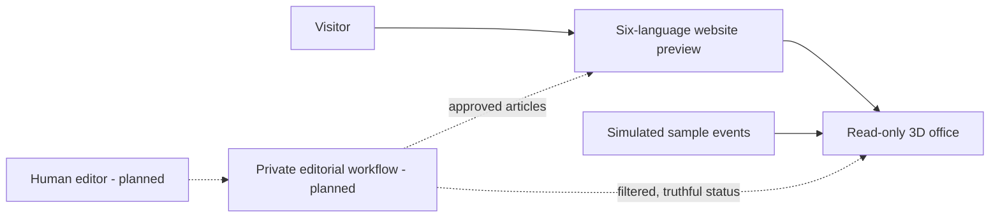

# Tasmania Student Notes

**English** · [简体中文](README.zh-CN.md)

An independent, student-led publication in Tasmania. Technology and AI are the starting points; student projects, study-to-work experiences, personal reflections and everyday life also belong. Students from different institutions and disciplines are welcome. This is not an official university or student-association publication.

**[Explore the website preview](https://tas-stu-notes-preview.azurewebsites.net/)** · **[View the LinkedIn Page](https://www.linkedin.com/company/144045910/)**

This is a **portfolio showcase**, not the full source repository. It contains a project account and public-safe screenshots. The website is a prototype, and the 3D office shows **simulated agents**, not a live autonomous editorial team.

## At a glance

| | |
| --- | --- |
| Audience | Students across Tasmania, regardless of institution or field |
| Editorial starting point | Practical technology and AI writing, with room for student viewpoints and reflections |
| Online now | Six-language website preview with a read-only 3D office simulation embedded on the homepage |
| Behind the scenes | A private offline test harness and a separate local four-role Codex SDK trial using fictional material |
| Not online yet | Published articles, contributor intake, CMS, authenticated editor dashboard and real agent execution |
| Hosting | Azure App Service preview |
| Snapshot | 29 October 2026 |

## What visitors can try

1. Open the [website preview](https://tas-stu-notes-preview.azurewebsites.net/). Switch among English, Simplified Chinese, Bangla, Nepali, Korean and Vietnamese.
2. Use the “3D office” navigation item to see the scene in the homepage's behind-the-scenes section. The full-size view is linked above it. Changing the language in either the page or the embedded scene updates both.
3. Click a character to see its sample status, current task and recent activity. This is a read-only demonstration: the tasks and movement are generated examples, not records of real editorial work.

| English office | Chinese agent detail |
| --- | --- |
|  |  |

The language switch also covers the visitor-facing office labels, sample tasks, status text, work steps and text drawn on the in-scene task board. The non-English copy is an initial AI-assisted translation and needs native-speaker review before a production publication.

## Why this exists

The publication is meant to make useful student thinking visible without requiring every contribution to start as a polished article. A technical note can show what was tested and where it failed. A personal piece can show how a view was formed or changed. The website gives these different kinds of work a common home.

There is a second, operational question: can AI help a small editorial team research, draft, check and translate without becoming its own unchecked approver? The current project explores that question in stages. The public 3D office is a visual prototype; it does not claim that this workflow is already running.

## Current system and intended direction

The current public site consists of a small Node.js server, multilingual static content and a 3D scene adapted from [The Roving Office](https://github.com/atlassian-labs/roving-office). The simulation is isolated from private project data. Visitors cannot create offices, control agents or publish content through this preview.

The private project has two distinct local tests. A deterministic offline harness checks role separation, source conflicts, budget stops and the human approval gate without calling a model. A separate four-role Codex SDK trial made real model calls using fictional material and sent filtered status events to a private local office. Neither test drives the public 3D scene. The planned five-model project API trial is paused. Future operation needs authenticated roles, source and permission records, a real editorial queue, cost limits and a separate sanitised public status feed. A human must approve publication. LinkedIn access and posting remain manual.

## Evidence and limits

These are dated checks, not claims of a production editorial service:

| Check | Result | What it establishes |
| --- | --- | --- |
| Public preview, 29 October 2026 | Embedded office rendered on the Azure homepage and the full-size office route remained available | The public visual simulation is reachable; it does not prove live agents. |
| Language completeness, 29 October 2026 | 49 website content fields and 49 office phrases complete in all six languages | Required text entries are present and current; native-speaker quality review remains outstanding. |
| Private agent-core tests, 29 October 2026 | 17 of 17 passed | The local test harness checks evidence conflicts, role boundaries and stopping rules. Its source is not published in this showcase. |
| Local Codex SDK trial, 28 October 2026 | Four separate role sessions; unsupported draft text triggered `correction_needed`; 16 of 16 filtered status events reached the private office receiver | A bounded local experiment, not the public website backend or a five-model API test. |

## My part

As project owner, I defined the publication's scope and the public/private access boundary, chose a reuse-first direction for the visual prototype, and guided an AI-assisted implementation of the website and its six-language office preview. I checked the running site and kept the simulated scene clearly separate from the still-private editorial workflow. The 3D renderer itself is adapted open-source work, not original code written from scratch for this project.

## What is not finished

- No articles or student submissions are being collected through this site yet.
- The 3D characters are simulated; there is no public view of real agent work.
- The editor/admin experience, CMS, database and live multi-agent runner are not deployed.
- The translations have completeness checks but not native-speaker approval.
- The Azure address is a preview, not a promise of a permanent production service.

## Public versus private

This repository intentionally contains **no application source code**, draft articles, student submissions, contact lists, prompts, API credentials, private agent logs or deployment configuration. The full working project is backed up separately in a private repository. Public updates will be curated and checked before they are added here.

## Third-party work and rights

The 3D office uses adapted Apache-2.0 code and visual work from Atlassian Labs’ *The Roving Office*. The upstream’s excluded brand marks were replaced or omitted in the website adaptation. See [ATTRIBUTION.md](ATTRIBUTION.md) for the pinned version and rights boundary. This repository does not grant a licence to reuse the Tasmania Student Notes name, logo, screenshots or editorial material.
