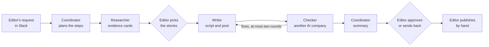

# Tasmania Student Notes

**English** · [简体中文](README.zh-CN.md)

Tasmania Student Notes (TSN) is an independent, student-led publication for students across Tasmania, whatever they study and wherever they come from. Its website is written in seven languages: English, Simplified Chinese, Traditional Chinese, Bangla, Nepali, Korean and Vietnamese.

Behind it is a small newsroom of AI agents. A Coordinator, a Researcher, a Writer and a Checker take a request from Slack and work through it on one self-hosted board. The Checker runs on a different AI company's model from the other three, so no model checks its own writing. A human editor picks the stories, approves every final result and publishes by hand.

This is an independent student project. It is not a University of Tasmania or Tasmanian Government publication. The website carries the two TSN Weekly Briefs and one Page post that the editor first published on LinkedIn. Students can pitch an idea by email to a human editor; the AI agents cannot read that inbox.

The website and newsroom source, prompts, agent logs and drafts live in a private repository. This repository is a curated showcase: an account of the project, screenshots of the public preview, a poster and dated results only. The source code can be shown on request: [contact me on LinkedIn](https://www.linkedin.com/in/evan-h-165976301/).

<table>
<tr>
<td></td>
<td></td>
</tr>
<tr>
<td align="center"><a href="https://tas-stu-notes-preview.azurewebsites.net/office/">Pixel office: recorded agent runs, replayed</a></td>
<td align="center"><a href="media/poster.jpg">Poster, 16 Nov 2026</a></td>
</tr>
</table>

**Website preview:** [Tasmania Student Notes](https://tas-stu-notes-preview.azurewebsites.net/)
— seven languages, in the look of TSN's own Weekly Brief videos on top of Ghost's Headline theme, with the published
Weekly Briefs (captioned videos and their sources), page search, share links and an RSS feed per language. It opens in
English unless you pick a language.

**LinkedIn Page:** [Tasmania Student Notes on LinkedIn](https://www.linkedin.com/company/144045910/)
— where the editor posts the TSN Weekly Brief, a short weekly news video. Every post is published by hand; no agent
posts there.

**Pixel office:** [recorded agent runs](https://tas-stu-notes-preview.azurewebsites.net/office/)
— four recorded pilot runs of the agents, replayed with simulated breaks in between. The recordings keep only who moved
and when, never titles or text. The page says it is a replay and never shows live work.

**How a story is made:** [the agents and the editor](https://tas-stu-notes-preview.azurewebsites.net/how-we-work/)
— the four agents, the human editor and who approves what.

**Contribute:** [send an idea by email](https://tas-stu-notes-preview.azurewebsites.net/join-in/)
— a short pitch is enough. A human editor reads every message, nothing is published without the writer's agreement,
and AI tools are used on a contribution only after asking.

The public preview. The latest Weekly Brief leads the home page; the bar at the top says the site is a preview and that a human editor approves every piece before it goes out.

## Contents

- [At a glance](#at-a-glance)
- [The problem](#the-problem)
- [Who it is for](#who-it-is-for)
- [One story, start to finish](#one-story-start-to-finish)
- [The screens](#the-screens)
- [What works today](#what-works-today)
- [Design principles](#design-principles)
- [Real material and fictional material](#real-material-and-fictional-material)
- [How it was built](#how-it-was-built)
- [Problems that became rules](#problems-that-became-rules)
- [Technology stack](#technology-stack)
- [Verification evidence](#verification-evidence)
- [Security and boundaries](#security-and-boundaries)
- [What is not finished](#what-is-not-finished)
- [What the project showed](#what-the-project-showed)
- [Public and private](#public-and-private)
- [Copyright and terms](#copyright-and-terms)

## At a glance

| | |
|---|---|
| What it is | A seven-language student publication for Tasmania, with a newsroom of four AI agents in which a human editor approves every final result |
| Who it is for | Students across Tasmania, whatever they study and wherever they come from |
| The problem | What students need to know about study, work and life in Tasmania is scattered and mostly in English, and AI help that nobody checks spreads mistakes |
| AI agents | The Coordinator, Researcher and Writer run on Claude through Claude Code; the Checker runs on OpenAI's Codex. They share a self-hosted Multica board and one locked container on the editor's computer |
| Who decides | The Coordinator approves routine hand-offs. The editor picks the stories and approves every final result. A guard reopens anything an agent closes beyond its rights |
| Stack | A Node.js website on Ghost's Headline theme with TSN's own look, hosted on Azure App Service; Multica, Docker Compose, Slack, Claude Code and OpenAI Codex for the newsroom; Pixel Agents art and The Roving Office simulation for the office |
| Evidence | 50 automated newsroom tests, a seven-language check on every build, a tiered-approval pilot and a real-news rehearsal with two check rounds |
| Material | Pilot runs used fictional material; one rehearsal used real public news and was not published. The agent newsroom holds no student data |
| Status | A preview website with two published Weekly Briefs, and a private newsroom pilot that has not yet produced a published issue |

## The problem

Students in Tasmania read in many languages, and much of what they need to know about study, work and local life is scattered and written in English. A small student team cannot research, check and translate everything itself. AI can help, but a publication that uses it has to be able to answer these questions about every piece:

- Which source backs each claim, and did someone other than the writer open it?
- Did any AI approve its own work?
- Who chose the stories, and who approved the final text?
- Can an AI agent post, email or contact anyone on its own?
- When the site shows agents at work, is it live, a replay or a simulation?
- Is every language complete, or is one quietly out of date?

Tasmania Student Notes builds those answers into how the newsroom and the website work.

## Who it is for

| Role | The question they need answered | What TSN shows them |
|---|---|---|
| Student reader | Is there something here for me, in a language I read well? | Seven languages; the Weekly Brief as a captioned video with its sources; sections on technology and AI, student voices, study to work and life in Tasmania; an RSS feed per language |
| Would-be contributor | Can I share an idea without a finished article? | A Contribute page that asks for a short pitch by email and says what happens next: a human editor reads it, and nothing is published without the writer's agreement |
| Human editor | What did each agent do, and what is waiting for me? | One board on which every step is attributed to an agent, a Blocked status when a choice is needed, a summary at the end and a private live office view |
| Reviewer of the project | Is the AI work checked, and labelled honestly? | A Checker on another company's model, a guard outside the agents' reach, and replays that say they are replays |

These roles describe the intended audience. Pitches by email opened on 18 November 2026.

## One story, start to finish

The flow below is the TSN Weekly Brief, a short weekly news video, as the agents rehearsed it on 15 November 2026.

1. **A request arrives.** The editor writes to the Coordinator in Slack. The message becomes a main issue on the board, and every later step is a sub-issue assigned to one agent.
2. **The Coordinator plans.** It creates three steps: research, writing and fact check. It hands work on and approves routine hand-offs, but it cannot close the main issue.
3. **Research.** The Researcher searches and reads public web pages and writes an evidence card for each candidate story: the outlet, the source's own date, the address, when it was read, and the wording behind each claim.
4. **The editor picks.** The Coordinator stops, marks the main issue Blocked and asks the editor to choose the stories and their order, with a recommendation.
5. **Writing.** The Writer has no web tools. Using only the evidence cards, it writes the script, the voice lines, the post text and a list of every claim with its source. Lines that are TSN's own advice are marked as advice.
6. **The check.** The Checker runs on OpenAI's Codex and opens every source itself. It labels each claim supported, overstated, wrong, unverified or a wording issue. The Writer fixes what it marks, for at most two rounds, and neither the Writer nor the Coordinator can overrule a verdict.
7. **Summary and approval.** The Coordinator writes a summary, moves the main issue to In Review and asks the editor, who approves it or sends it back.
8. **Publication.** The editor publishes by hand. No agent can post, email or contact anyone, and no automation touches LinkedIn. A guard outside the agents' reach reopens any main issue an agent closes.

In the rehearsal the first check marked three claims overstated and one figure unverified. After one round of fixes the Checker found all 19 claims supported. Nothing was published.

## The screens

| | |
|---|---|
|  |  |
| **How a story is made.** The four agents, the editor, and who approves what | **On a phone.** English, Traditional Chinese and Bangla, three of the seven languages |

**A published Weekly Brief.** The video with English captions, then each story with its takeaway, and the sources. Titles and summaries are in all seven languages; the stories are in English for now, and the other languages say so.

**Terms and privacy.** All rights reserved; no accounts, ads, analytics or cookies; emails are kept only to reply and are deleted on request.

## What works today

| Capability | Status | Evidence |
|---|---|---|
| Seven-language website | Live on the preview | 19 pages on Ghost's Headline theme (MIT) with TSN's own look. A check on every build confirms 173 fields in all seven languages |
| Published Weekly Briefs | Live on the preview | Issues 1 and 2 and the "Meet the newsroom" post, first published by the editor on LinkedIn: captioned videos, stories and sources. The stories are in English for now |
| Contributions by email | Live on the preview | A Contribute page asks for a short pitch by email. Only the editor reads that inbox; the agents cannot |
| Search, sharing and RSS | Live on the preview | Page search (the magnifier or Ctrl+K), a share panel whose links open only on a visitor's click, and one RSS feed per language |
| Terms and privacy | Live on the preview | All rights reserved; no accounts, ads, analytics or cookies. An AI-assisted draft that a lawyer has not yet checked |
| Pixel office replays | Live on the preview | Four recorded runs, each labelled by its material. The public site has no live-event route |
| Agent newsroom | Tested locally | Four agents on a self-hosted Multica board, started from Slack, in one locked container on the editor's computer |
| Tiered approval and guard | Tested locally | The Coordinator may close only sub-steps; a guard reopens anything else an agent closes |
| Cross-company check | Tested locally | The Checker on OpenAI's Codex labels each claim, with at most two rounds of fixes |
| Weekly news brief workflow | Rehearsed once | A shared playbook for research, writing and checking; one rehearsal on real news, not published |
| Tasmania leads | Tried once | Before research starts, a script on the editor's computer gathers the week's Tasmanian news items and the Premier's media releases into a list of leads for the Researcher. Leads, never sources |
| Private live office | Tested locally | Follows the board in real time on the editor's computer only; a recorder keeps sanitised movements |
| Upload form, contributor accounts and a content system | Planned | Not built; pitches come by email |

## Design principles

- **A person approves every final result.** Agents prepare text; the editor picks, approves and publishes.
- **No AI approves its own work.** The Checker runs on another company's model, and the Writer and the Coordinator cannot overrule its verdicts.
- **The Writer works from evidence, not from the open web.** Only the Researcher and the Checker can read web pages.
- **Text is material, not instructions.** Anything quoted, pasted, attached or read on the web is something to work on, never an order.
- **Agents cannot reach out.** No agent can post, email or contact anyone, and no automation opens LinkedIn.
- **Closing work is the editor's.** A guard outside the agents' reach reopens any main task an agent closes.
- **Replays say they are replays.** Recordings keep only movements, a person reviews each one, and the public office never presents them as live work.
- **Every language, or a clear notice.** A change to the site's text ships only when all seven languages are updated. A published piece whose stories are not translated yet says so in each language.
- **Reuse before building.** The theme, the office art, the office simulation and the board are maintained open-source work, used under their licences.

## Real material and fictional material

| Run | Material | Published |
|---|---|---|
| Pilot runs, 13 Nov 2026 (three public replays) | Fictional tasks written for the test | No |
| News brief rehearsal, 15 Nov 2026 (fourth public replay) | Real public news, chosen by the editor | No |
| TSN Weekly Brief issues 1 and 2 (5 and 14 Nov 2026) | Real public news | Yes, posted by the editor on the project's LinkedIn Page, and on the website since 18 Nov 2026. Issue 1 was made by one Claude Code session; issue 2 was written by one session and checked by a separate one in two rounds. Neither went through the agent newsroom |

The agent newsroom holds no student data. Pitches sent by email stay in an inbox that only the editor reads.

## How it was built

As project owner, I set the publication's scope and the line between public and private, chose to reuse proven open-source work instead of building from scratch, and decided who may approve what. AI coding assistants (Claude Code and Codex) did much of the building under my direction, and I checked each step in the running system.

| Date | What it added |
|---|---|
| 24 Oct 2026 | Private repository, an offline prototype of the four roles and a simulated office preview |
| 5 Nov 2026 | TSN Weekly Brief issue 1, posted by the editor |
| 10 Nov 2026 | The office redrawn in pixel art (Pixel Agents art, The Roving Office simulation) |
| 12 Nov 2026 | Slack and a self-hosted Multica board; the agents moved into one locked container |
| 13 Nov 2026 | First Slack-to-board run; tiered approval and the guard; a private live office view, a recorder and the first public replays; the site rebuilt on Ghost's Headline theme; a terms and privacy page; deployed to the Azure preview |
| 14 Nov 2026 | TSN Weekly Brief issue 2, posted by the editor |
| 15 Nov 2026 | A shared playbook for the Weekly Brief; web access for the Researcher and the Checker only; the first real-news rehearsal through the agents; a fourth public replay |
| 18 Nov 2026 | Traditional Chinese, making seven languages; TSN's own look, taken from the Weekly Brief videos; the two Weekly Briefs and a Page post on the website; pitches by email; Tasmania leads for the Researcher, tried once; deployed to the Azure preview |

## Problems that became rules

| What went wrong | What changed |
|---|---|
| In the first full run, the Coordinator told each step to wait until the one before was closed, so the Writer stopped as Blocked | Decision rights were written down: the Coordinator approves routine hand-offs itself, and only big decisions go to the editor |
| Agents can technically set any status, including closing work that should be the editor's | A separate guard, out of the agents' reach, reopens anything an agent closes beyond its rights |
| A request sent from Slack was attached to an older issue, so research ran twice | A request from Slack or chat now always opens a new main issue |
| The Checker wrote its hand-off mention in the wrong form, and the run stalled for about ten minutes until the editor stepped in | Every agent now copies the mention exactly as given |
| In Weekly Brief issue 2, sources disagreed on when an outage began | The playbook says: when sources disagree, say so and use the safer wording |
| The replay export labelled every run as fictional, but the 15 Nov rehearsal used real news | Each replay now records its material, and the public office names it |
| The Premier's media-release site refused the agents' web tools | The editor's computer fetches the week's releases before research starts and attaches them as leads |
| The home page looked like an empty newspaper: a news theme with no stories in it | Published pieces now lead the home page, in the look readers already know from the Weekly Brief videos |

## Technology stack

- Website: Node.js with no framework, a page generator, Ghost's Headline theme (MIT) under TSN's own styles; Inter, Barlow Condensed and JetBrains Mono fonts, self-hosted
- Video: 720p MP4 with WebVTT captions, loaded only when a visitor presses play
- Hosting: Azure App Service, free tier, deployed as a ZIP of exactly the files the server serves
- Newsroom: a self-hosted Multica board with PostgreSQL, Docker Compose and Slack
- Agents: Claude Code (Coordinator, Researcher, Writer) and OpenAI Codex (Checker)
- Office: Pixel Agents art (MIT) and The Roving Office simulation (Apache-2.0)
- Checks: Node's built-in test runner, a seven-language completeness check and a guard service

More detail: [How the newsroom works](docs/how-the-newsroom-works.md).

## Verification evidence

Dated checks, not claims of a production newsroom:

| Check | Result | What it shows |
|---|---|---|
| Newsroom tests, 18 Nov 2026 | 50 of 50 passed | Rules for the guard, the office feed, the recorder, the replay export and the Tasmania leads behave as written. The code is private |
| Language check, 18 Nov 2026 | 173 site fields and 59 office phrases complete in seven languages, across 19 pages | Every language is complete and current. It does not prove translation quality |
| News brief rehearsal, 15 Nov 2026 | From a Slack request to the Coordinator's summary in about 25 minutes. Check round 1: 3 claims overstated, 1 unverified; round 2: all 19 supported | The agents can carry a real news task from start to finish while the editor chooses the stories. It was one rehearsal; nothing was published |
| Tiered-approval pilot, 13 Nov 2026 | Three Coordinator approvals in about 90 seconds; the guard reverted nothing | The agents followed the approval rules on fictional material. It was a short pilot, not sustained operation |
| Public preview, 13–18 Nov 2026 | Pages, feeds, videos and replays answered; write requests were refused; the live-event route is absent; no cookies are set | The public site is read-only and cannot show live work |

## Security and boundaries

- The four agents run in one container with a read-only file system and no extra privileges. They cannot load user-level instructions, plug-ins or saved memory, and each task runs in its own working folder, one task at a time.
- Only the Researcher and the Checker can read the web. Their access is not yet limited to a list of approved sites.
- The container holds the agents' own sign-ins, so a misled agent could in theory read them. That is why only fictional material and public news go through it, never student submissions or private data.
- The guard corrects after the fact; it cannot stop an action in advance.
- The board and the live office view listen only on the editor's computer. Nothing in the newsroom is reachable from the internet.
- The public website does not connect to the newsroom. It accepts no writes and receives only replay files that a person has exported and checked.
- Pitches arrive by email in an inbox the agents have no access to.
- The non-English text is AI-assisted and still needs review by native speakers, and the terms page still needs a lawyer's review.

## What is not finished

- Published stories are in English for now; their titles and summaries are translated.
- Contributions come by email only: there is no upload form, account or content system yet.
- The newsroom has run short pilots on fictional material and one rehearsal on real news. It has not yet produced a published issue.
- All four agents share one container; a container for each role is planned.
- Web access is not limited to a list of approved sites.
- The guard reacts after the fact.
- A content system, contributor accounts and a public view of live work are planned, not built.
- The Azure address is a preview, not a permanent service.

## What the project showed

- In a multi-agent workflow, small hand-off details decide whether a run finishes: one malformed mention stalled a whole run.
- A checker from another AI company caught overstated wording that the writer had produced from correct sources.
- An agent can technically do more than its instructions allow, so the step that matters most, closing work, is enforced from outside.
- Saying what a replay shows (a fictional task, an unpublished rehearsal) matters as much as showing it.
- Reusing maintained open-source work produced a credible site in days and left the effort for rules and checks.

## Public and private

This repository contains no source code, drafts, student submissions, contact lists, prompts, credentials, agent logs or deployment settings. The working project is kept in a separate private repository, and this showcase does not share its history. [Publication boundary](docs/publication-boundary.md) lists what may appear here and how each update is checked.

## Copyright and terms

© 2026 Tasmania Student Notes. All rights reserved; see [LICENSE](LICENSE). Without written permission, nothing in this repository may be copied, republished or adapted, and the project's code and design may not be rebuilt, whether by hand, with automated tools or with AI cloning tools. The code may not be reverse engineered except where the law allows, and the content may not be scraped, bulk-downloaded or used to train or evaluate AI models. Uses the law already allows, such as fair dealing for review or news reporting, are not affected. Sharing links is welcome. Uses permitted by law, and GitHub's own viewing and forking permissions, still apply.

The site reuses open-source work that keeps its own licence: the Headline theme by Ghost (MIT), Pixel Agents art (MIT), The Roving Office simulation (Apache-2.0) and the Inter, Lora, Barlow Condensed and JetBrains Mono fonts (SIL Open Font License). See [THIRD_PARTY_NOTICES.md](THIRD_PARTY_NOTICES.md) and `third_party/`. Terms, licences and privacy: [terms page](https://tas-stu-notes-preview.azurewebsites.net/terms/).
