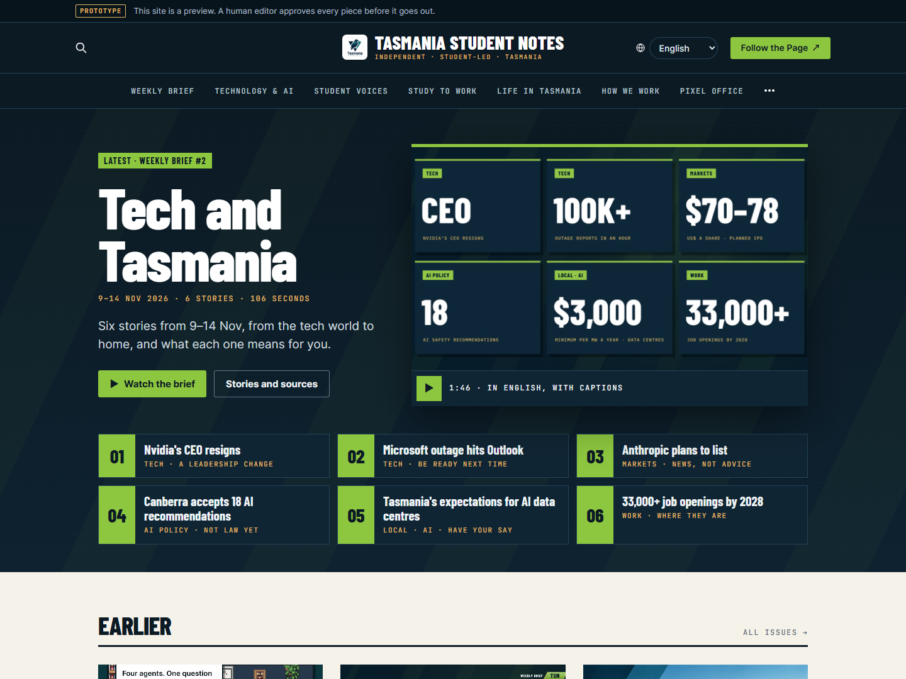
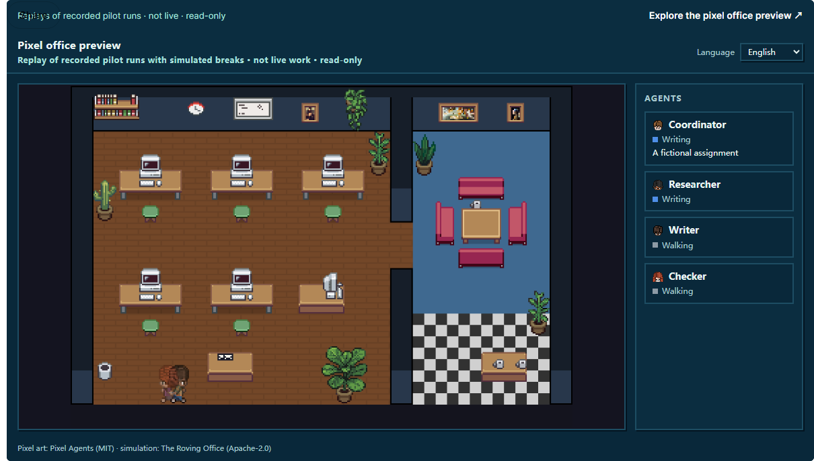
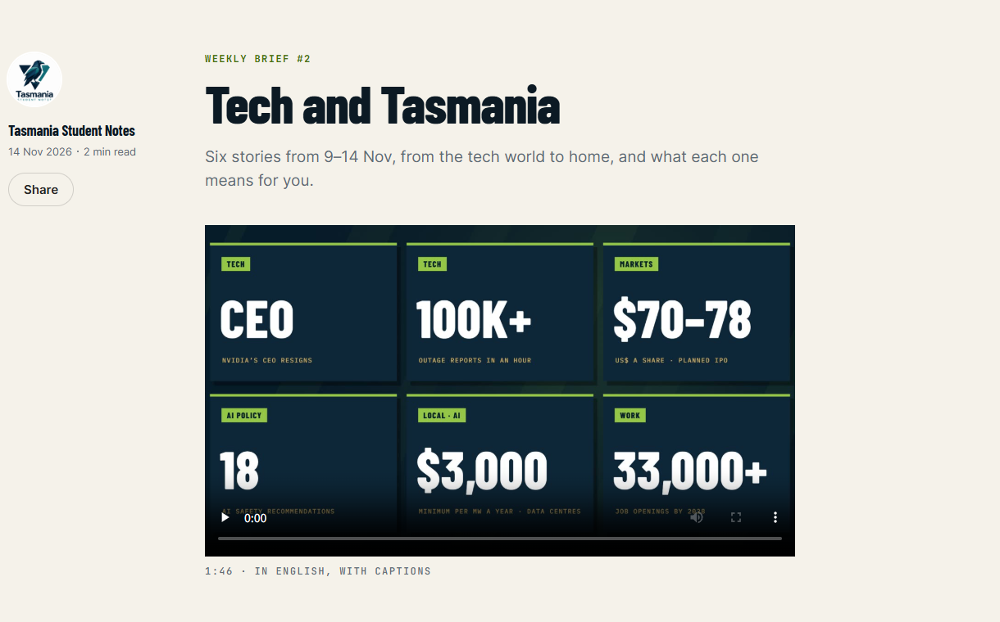
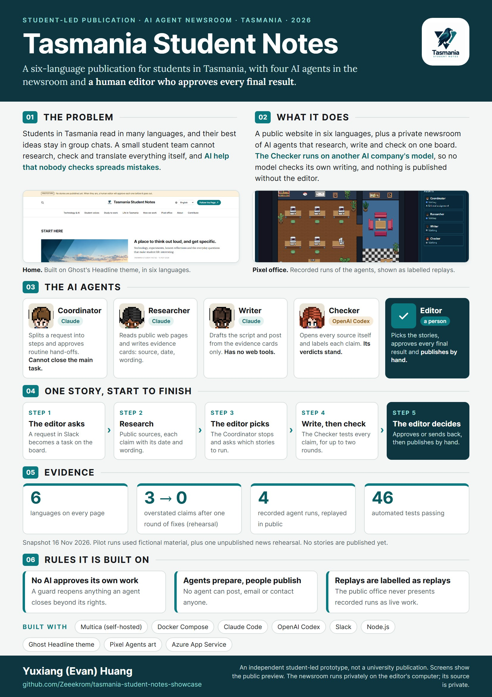

# Tasmania Student Notes

**English** · [简体中文](README.zh-CN.md)

A student publication for Tasmania in seven languages, made with a newsroom of AI agents in which a human editor approves every result.

<table>
<tr>
<td align="center" width="50%"> <b>Website</b> · preview, seven languages</td>
<td align="center" width="50%"> <b>Pixel office</b> · recorded runs, replayed</td>
</tr>
<tr>
<td align="center" width="50%"> <b>Weekly Brief</b> · captioned video and sources</td>
<td align="center" width="50%"> <b>Poster</b></td>
</tr>
</table>

Also: [LinkedIn Page](https://www.linkedin.com/company/144045910/) · [Instagram](https://www.instagram.com/tasmaniastudentnotes/), where each Weekly Brief appears once the editor has approved it.

**What you can check**

- **Seven languages, or a clear notice.** Every page is in English, Simplified and Traditional Chinese, Bangla, Nepali, Korean and Vietnamese; a story not yet translated says so. → [switch the language](https://tas-stu-notes-preview.azurewebsites.net/?lang=bn)
- **Every story shows its sources.** Each Weekly Brief on the site lists the source behind each story, with links. → [Weekly Brief #2](https://tas-stu-notes-preview.azurewebsites.net/weekly-brief-2/)
- **A replay says it is a replay.** The office plays back recorded test runs and labels them; it never presents them as live work. → [office](https://tas-stu-notes-preview.azurewebsites.net/office/)
- **Readers can ask or report a mistake.** The feedback panel looks for an answer on the site first and only then sends the message to the editor. → [questions readers ask](https://tas-stu-notes-preview.azurewebsites.net/about/#faq)
- **It counts views, not people.** No cookies and no IP addresses; the privacy section says exactly what is kept. → [terms](https://tas-stu-notes-preview.azurewebsites.net/terms/#privacy)

Showcase only: no source code, and not a university publication. → [Status, source &amp; terms](#status-source--terms)

## The problem

Students in Tasmania read in many languages, and much of what they need to know about study, work and local life is scattered and in English. A small student team cannot research, check and translate it all. AI can help, but a publication that uses it must be able to say, for every piece:

- which source backs each claim, and whether someone other than the writer opened it;
- that no AI approved its own work, and who approved the final text;
- that no AI agent can post, email or contact anyone on its own;
- whether a view of the agents at work is live, a replay or a simulation;
- that every language is complete, or says it is not.

## Who it is for

| Role | What TSN shows them |
|---|---|
| Student reader | Short Weekly Brief videos with captions and sources, in a language they read well, plus an RSS feed per language |
| Would-be contributor | A pitch by email is enough; a human editor reads it, and nothing is published without the writer's agreement |
| Human editor | One board where every step is attributed to an agent, and the decisions that are theirs are waiting for them |

## One story, start to finish

1. **The editor asks.** A request in Slack becomes a task on a self-hosted board; a Coordinator agent splits it into research, writing and a check.
2. **Research.** A Researcher agent reads public sources and records, for every claim, where it came from and when it was read.
3. **The editor picks** which stories run, and in what order.
4. **Writing.** A Writer agent, with no web access, writes only from that evidence.
5. **The check.** A Checker on another AI company's model opens every source again and marks each claim; the Writer fixes what it marks.
6. **Approval.** The editor approves or sends back, and publishes by hand.

In a rehearsal on real news (15 Nov 2026), the first check flagged three overstated claims and one it could not verify; after one round of fixes all 19 claims were supported. Nothing from that rehearsal was published.

## How it is kept honest

- **A person approves every result.** Agents prepare; the editor picks, approves and publishes.
- **No AI checks its own writing.** The Checker runs on a different company's model, and neither the Writer nor the Coordinator can overrule it.
- **Closing work is enforced from outside.** An agent can technically do more than its instructions allow, so a separate guard reopens anything an agent closes beyond its rights.
- **Agents cannot reach out.** No agent can post, email or contact anyone, and reader messages are treated as material, never as instructions.
- **Small hand-offs decide whether a run finishes.** One malformed hand-off once stalled a whole run; such details are now written into each agent's rules.

## What it can and can't do today

- **Working now** — the seven-language preview site with the Weekly Briefs, the office replays, contributions by email and the reader feedback panel; the Weekly Brief itself, three issues so far, on LinkedIn and Instagram.
- **Tested, not yet routine** — the four-agent newsroom has run pilots on fictional material and one rehearsal on real news, on the editor's own computer; no issue has yet gone through it end to end.
- **Not built** — an upload form, contributor accounts and a content system; story bodies are in English only for now, and the translations and terms still need native-speaker and legal review.

## Want the details?

The source, a code tour on a call, how the newsroom is wired, the decision records, the tests and the agents' instructions aren't published here; they're available on request — [message me on LinkedIn](https://www.linkedin.com/in/evan-h-165976301/) or email [yuxianghuang2026@gmail.com](mailto:yuxianghuang2026@gmail.com).

## Status, source &amp; terms

An independent, student-led project, **not a University of Tasmania or Tasmanian Government publication**. The website is a preview. This repository is a curated showcase: the write-up, screenshots of the public preview and a poster, with no source code, drafts, submissions, contacts, prompts or logs. [Publication boundary](docs/publication-boundary.md) says what may appear here.

© 2026 Tasmania Student Notes. All rights reserved; see [LICENSE](LICENSE). Without written permission, nothing in this repository may be copied, republished or adapted, and the project's code and design may not be rebuilt, whether by hand, with automated tools or with AI cloning tools. The code may not be reverse engineered except where the law allows, and the content may not be scraped, bulk-downloaded or used to train or evaluate AI models. Uses the law already allows, such as fair dealing for review or news reporting, are not affected. Sharing links is welcome. The site reuses open-source work that keeps its own licence (Ghost's Headline theme, Pixel Agents art, The Roving Office simulation and several open fonts); see [THIRD_PARTY_NOTICES.md](THIRD_PARTY_NOTICES.md). Full terms: [terms page](https://tas-stu-notes-preview.azurewebsites.net/terms/).
