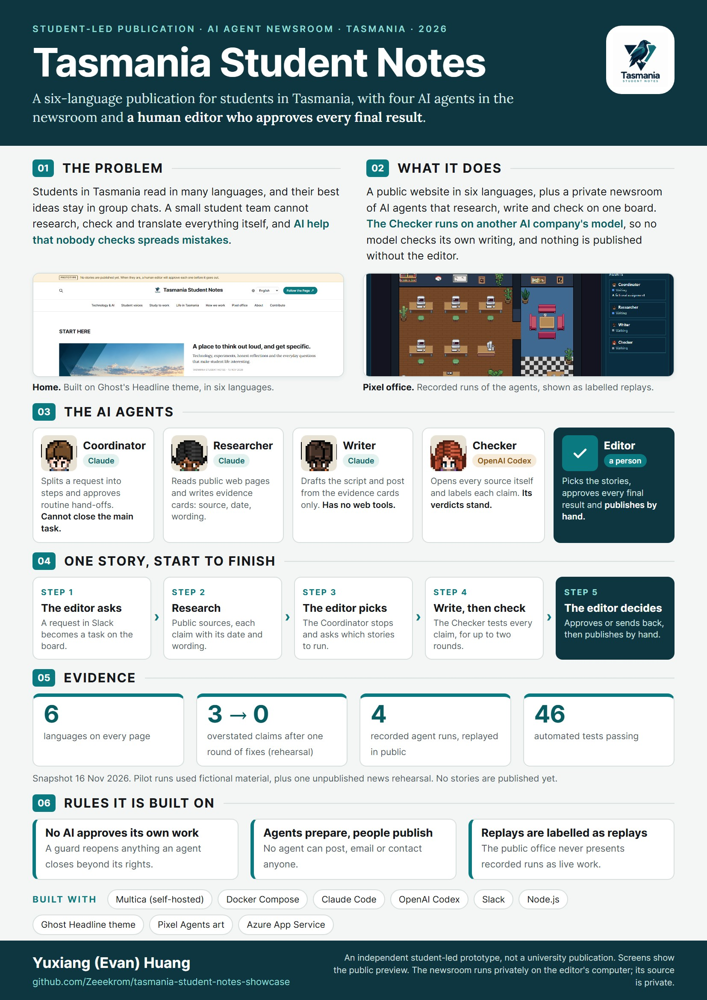
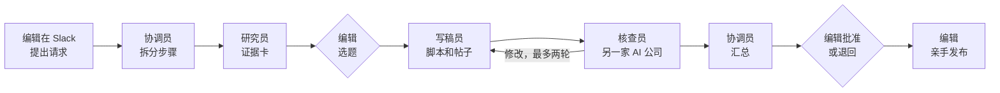
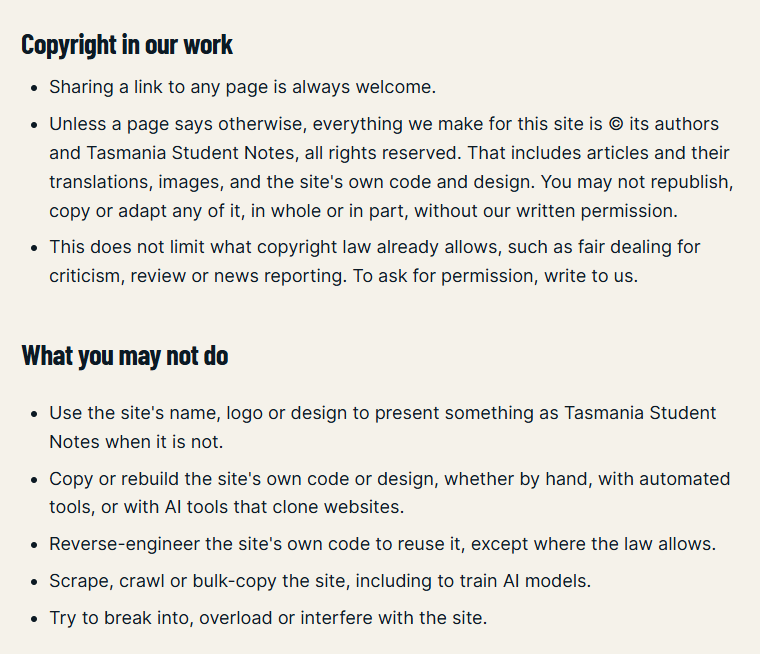

# Tasmania Student Notes｜塔斯马尼亚学生笔记

[English](README.md) · **简体中文**

Tasmania Student Notes（TSN）是一份独立的、由学生主导的刊物，写给塔州的学生，不分专业、不分来自哪里。网站有六种语言：英语、简体中文、孟加拉语、尼泊尔语、韩语和越南语。

刊物背后是一个由 AI 智能体组成的小编辑部。协调员、研究员、写稿员和核查员从 Slack 接到请求，在同一块自托管的看板上把它做完。核查员用的是另一家 AI 公司的模型，和其他三个不同，所以不会有模型核查自己写的东西。人类编辑负责选题、批准每一份最终成果，并亲手发布。

这是一个独立的学生项目，不是塔斯马尼亚大学或塔州政府的刊物。网站上还没有发表任何文章，也还没有收集学生投稿。

网站和编辑部的源码、提示词、智能体日志和草稿都在私有仓库里。这个仓库是精选的展示版，只放项目介绍、公开预览站的截图、一张海报和带日期的结果。

<table>
<tr>
<td></td>
<td></td>
</tr>
<tr>
<td align="center"><a href="https://tas-stu-notes-preview.azurewebsites.net/office/?lang=zh-Hans">像素办公室：智能体工作录像回放</a></td>
<td align="center"><a href="media/poster.jpg">海报，2026 年 11 月 16 日</a></td>
</tr>
</table>

**网站预览：** [Tasmania Student Notes](https://tas-stu-notes-preview.azurewebsites.net/?lang=zh-Hans)
——六种语言，基于 Ghost 的 Headline 主题，有站内搜索、分享链接和每种语言各自的 RSS 订阅。默认是英文，除非你自己选了别的语言。还没有发表文章。

**像素办公室：** [智能体工作录像](https://tas-stu-notes-preview.azurewebsites.net/office/?lang=zh-Hans)
——回放四段录下来的智能体试运行，中间穿插模拟的休息时间。录像只保留谁在什么时候做了什么动作，不保留标题和文字。页面写明这是回放，从不显示实时工作。

**一篇文章是怎么做出来的：** [智能体和编辑](https://tas-stu-notes-preview.azurewebsites.net/how-we-work/?lang=zh-Hans)
——四个智能体、人类编辑，以及谁批准什么。

公开预览站。顶部的提示条写着现在的真实情况：还没有发表文章；以后每一篇在发出前，都要由人类编辑批准。

## 目录

- [一眼看懂](#一眼看懂)
- [要解决的问题](#要解决的问题)
- [给谁用](#给谁用)
- [一篇稿子从头到尾](#一篇稿子从头到尾)
- [界面](#界面)
- [现在已经做到的](#现在已经做到的)
- [设计原则](#设计原则)
- [真实材料与虚构材料](#真实材料与虚构材料)
- [怎么一步步做出来的](#怎么一步步做出来的)
- [出过的问题怎样变成规则](#出过的问题怎样变成规则)
- [技术栈](#技术栈)
- [验证证据](#验证证据)
- [安全与边界](#安全与边界)
- [还没做完的](#还没做完的)
- [这个项目说明了什么](#这个项目说明了什么)
- [公开与私有](#公开与私有)
- [版权与条款](#版权与条款)

## 一眼看懂

| | |
|---|---|
| 是什么 | 一份写给塔州学生的六语刊物，背后是四个 AI 智能体组成的编辑部，每一份最终成果都由人类编辑批准 |
| 给谁 | 塔州的学生，不分专业、不分来自哪里 |
| 要解决的问题 | 学生需要知道的学习、工作和在塔州生活的信息很分散，而且大多是英文；没人核查的 AI 协助会把错误传出去 |
| AI 智能体 | 协调员、研究员、写稿员通过 Claude Code 使用 Claude；核查员用 OpenAI 的 Codex。它们共用一块自托管的 Multica 看板，在编辑电脑上的同一个上锁容器里运行 |
| 谁来决定 | 协调员批准步骤之间的常规交接；编辑负责选题并批准每一份最终成果；守卫程序会重新打开智能体越权关闭的任务 |
| 技术 | Node.js 网站，基于 Ghost 的 Headline 主题，托管在 Azure App Service；编辑部用 Multica、Docker Compose、Slack、Claude Code 和 OpenAI Codex；办公室用 Pixel Agents 美术和 The Roving Office 模拟程序 |
| 证据 | 46 项编辑部自动测试、每次生成网站时的六语检查、一次分级批准试运行，以及一次核查了两轮的真实新闻彩排 |
| 材料 | 试运行用的是虚构材料；有一次彩排用了真实的公开新闻，没有发布。项目不保存任何学生数据 |
| 现状 | 一个预览网站和一个私下试运行的编辑部，还不是正式运营的刊物 |

## 要解决的问题

塔州的学生用很多种语言阅读，而他们需要知道的学习、工作和当地生活的信息很分散，大多还是英文。一个小小的学生团队没办法自己把所有东西都查清、核对、翻译好。AI 可以帮忙，但用了 AI 的刊物，对每一篇都要能回答这些问题：

- 每个说法靠哪个来源支撑？除了写的人，还有谁打开核对过？
- 有没有哪个 AI 批准了自己的工作？
- 选题是谁定的？最终文字是谁批准的？
- AI 智能体能不能自己发帖、发邮件或联系别人？
- 网站上显示智能体在工作时，那是实时的、回放，还是模拟？
- 每种语言都齐全吗？有没有哪一种悄悄过时了？

Tasmania Student Notes 把这些问题的答案做进了编辑部和网站的运作方式里。

## 给谁用

| 角色 | 他们需要回答的问题 | TSN 给他们看什么 |
|---|---|---|
| 学生读者 | 这里有没有适合我的内容，而且是我读得顺的语言？ | 六种完整的语言；科技与 AI、学生声音、从学习到工作、塔州生活几个栏目；每种语言各自的 RSS 订阅 |
| 想投稿的人 | 没有写好一整篇文章，也能分享想法吗？ | 投稿页说明一个问题、一个项目或一个观点怎样变成一篇稿子。投稿通道还没开放 |
| 人类编辑 | 每个智能体做了什么？哪些事在等我决定？ | 一块看板，每一步都记在某个智能体名下；需要选择时任务标为 Blocked；最后有汇总；还有一个私有的实时办公室画面 |
| 评估这个项目的人 | AI 的工作有没有被核查？标注是否诚实？ | 用另一家公司模型的核查员、智能体碰不到的守卫程序，以及写明是回放的回放 |

这些角色描述的是预期的读者和用户。目前还没有发表文章，也还没有学生投稿。

## 一篇稿子从头到尾

下面是 TSN Weekly Brief（每周一期的新闻短视频）的流程，也就是智能体在 2026 年 11 月 15 日彩排时走过的流程。

1. **请求进来。** 编辑在 Slack 里给协调员发消息。这条消息变成看板上的一个主任务，之后的每一步都是分给某个智能体的子任务。
2. **协调员拆分。** 它建好三步：研究、写稿、核查。它负责交接工作、批准常规交接，但不能关闭主任务。
3. **研究。** 研究员搜索、阅读公开网页，为每条候选新闻写一张证据卡：媒体名称、来源自己的日期、网址、阅读时间，以及每个说法对应的原文。
4. **编辑选题。** 协调员停下来，把主任务标为 Blocked，请编辑选定新闻和顺序，并附上自己的建议。
5. **写稿。** 写稿员没有网页工具。它只根据证据卡写出脚本、配音台词、帖子正文，以及一份列出每个说法及其来源的清单。属于 TSN 自己建议的句子会标明是建议。
6. **核查。** 核查员用 OpenAI 的 Codex，亲自打开每一个来源，给每个说法标上：有出处、说过头、错误、未能核实或措辞问题。写稿员按标注修改，最多两轮；写稿员和协调员都不能推翻核查员的结论。
7. **汇总和批准。** 协调员写汇总，把主任务移到 In Review，请编辑过目；编辑批准或退回。
8. **发布。** 由编辑亲手发布。智能体不能发帖、发邮件或联系任何人，也没有任何自动程序碰 LinkedIn。智能体碰不到的守卫程序会重新打开被智能体关闭的主任务。

这次彩排里，第一轮核查标出 3 处说过头、1 个数字未能核实。改过一轮之后，核查员确认全部 19 个说法都有出处。没有发布任何内容。

## 界面

| | |
|---|---|
|  |  |
| **一篇文章是怎么做出来的。** 四个智能体、编辑，以及谁批准什么 | **在手机上。** 英语、简体中文和孟加拉语，六种语言中的三种 |

**条款与隐私。** 保留所有权利；没有账户、广告、统计分析，也不设 Cookie。

## 现在已经做到的

| 功能 | 状态 | 证据 |
|---|---|---|
| 六语网站 | 预览站已上线 | 基于 Ghost Headline 主题（MIT）的 15 个页面；每次生成网站都检查 121 个字段的六种语言是否齐全 |
| 搜索、分享和 RSS | 预览站已上线 | 站内搜索（放大镜或 Ctrl+K）；分享面板里的链接只在访客点击时才打开；每种语言一个 RSS 订阅 |
| 条款与隐私 | 预览站已上线 | 保留所有权利；没有账户、广告、统计分析和 Cookie。这是 AI 协助起草的版本，还没请律师审过 |
| 像素办公室回放 | 预览站已上线 | 四段录像，每段都标明用的是什么材料；公开站没有实时事件接口 |
| 智能体编辑部 | 本机测试过 | 四个智能体在自托管的 Multica 看板上工作，从 Slack 发起，运行在编辑电脑上的同一个上锁容器里 |
| 分级批准和守卫 | 本机测试过 | 协调员只能关闭子任务；其他被智能体关闭的任务，守卫都会重新打开 |
| 跨公司核查 | 本机测试过 | 用 OpenAI Codex 的核查员逐条标注说法，最多改两轮 |
| 每周新闻简报流程 | 彩排过一次 | 研究、写稿、核查共用一份工作手册；用真实新闻彩排过一次，没有发布 |
| 私有实时办公室 | 本机测试过 | 只在编辑电脑上实时跟随看板；录像程序只保留处理过的动作记录 |
| 投稿、账户和内容管理系统 | 计划中 | 还没做 |

## 设计原则

- **每一份最终成果都由人批准。** 智能体只准备文字；选题、批准和发布都由编辑来做。
- **没有 AI 批准自己的工作。** 核查员用另一家公司的模型，写稿员和协调员都不能推翻它的结论。
- **写稿员根据证据写，不去网上找。** 只有研究员和核查员能读网页。
- **文字是材料，不是指令。** 引用的、粘贴的、附件里的或网上读到的内容，都只是要处理的材料，不是命令。
- **智能体不能对外联系。** 智能体不能发帖、发邮件或联系任何人，也没有任何自动程序打开 LinkedIn。
- **关闭任务是编辑的事。** 智能体碰不到的守卫程序会重新打开被智能体关闭的主任务。
- **回放就写明是回放。** 录像只保留动作，每段都要人看过；公开的办公室从不把它们当作实时工作展示。
- **六种语言要么都更新，要么都不发。** 访客能看到的文字改动，只有六种语言都更新了才上线。
- **先复用，再动手做。** 主题、办公室美术、办公室模拟程序和看板都是有人维护的开源成果，按各自的许可使用。

## 真实材料与虚构材料

| 运行 | 材料 | 是否发布 |
|---|---|---|
| 试运行，2026-11-13（三段公开回放） | 为测试编写的虚构任务 | 否 |
| 新闻简报彩排，2026-11-15（第四段公开回放） | 真实的公开新闻，由编辑选题 | 否 |
| TSN Weekly Brief 第 1、2 期（2026-11-05 和 11-14） | 真实的公开新闻 | 是，由编辑发在项目的领英主页上。第 1 期由一个 Claude Code 会话完成；第 2 期由一个会话撰写、另一个会话分两轮核查。两期都没有经过智能体编辑部 |

项目里任何地方都不保存学生数据。

## 怎么一步步做出来的

作为项目负责人，我确定了刊物的范围和公开与私有的边界，选择复用成熟的开源成果而不是从零开发，并规定了谁能批准什么。大部分搭建工作由 AI 编程助手（Claude Code 和 Codex）在我的指挥下完成，每一步我都在实际运行的系统里检查过。

| 日期 | 新增了什么 |
|---|---|
| 2026-10-24 | 私有仓库、四个角色的离线原型，以及一个模拟的办公室预览 |
| 2026-11-05 | TSN Weekly Brief 第 1 期，由编辑发布 |
| 2026-11-10 | 办公室改成像素画风（Pixel Agents 美术、The Roving Office 模拟程序） |
| 2026-11-12 | 接入 Slack 和自托管的 Multica 看板；智能体搬进同一个上锁容器 |
| 2026-11-13 | 第一次从 Slack 到看板的运行；分级批准和守卫程序；私有实时办公室画面、录像程序和第一批公开回放；网站改用 Ghost 的 Headline 主题重建；条款与隐私页；部署到 Azure 预览站 |
| 2026-11-14 | TSN Weekly Brief 第 2 期，由编辑发布 |
| 2026-11-15 | Weekly Brief 的共用工作手册；只给研究员和核查员开放网页；第一次用真实新闻让智能体彩排；第四段公开回放 |

## 出过的问题怎样变成规则

| 出了什么问题 | 改了什么 |
|---|---|
| 第一次完整运行时，协调员让每一步都等上一步关闭后再开始，结果写稿员停在 Blocked | 把决定权写清楚：常规交接由协调员自己批准，只有大事才交给编辑 |
| 智能体在技术上能把任务设成任何状态，包括本该由编辑关闭的任务 | 加了一个智能体碰不到的守卫程序，重新打开越权关闭的任务 |
| 一条从 Slack 发来的请求被挂到了旧任务上，研究跑了两遍 | 现在从 Slack 或聊天来的请求，一律新开主任务 |
| 核查员交接时 @ 协调员的写法不对，流程停了约十分钟，直到编辑出手 | 现在每个智能体都必须照原样复制这个 @ |
| Weekly Brief 第 2 期里，几个来源对一次故障的开始时间说法不一 | 工作手册规定：来源说法不一时，要写明分歧，并用更稳妥的说法 |
| 回放导出工具把每段录像都标成虚构材料，但 11 月 15 日的彩排用的是真实新闻 | 现在每段回放都记录自己用的材料，公开的办公室会写明 |

## 技术栈

- 网站：不用框架的 Node.js、一个页面生成程序、Ghost 的 Headline 主题（MIT）、Inter 和 Lora 字体
- 托管：Azure App Service 免费档，部署包里只放服务器实际提供的文件
- 编辑部：自托管的 Multica 看板（PostgreSQL）、Docker Compose 和 Slack
- 智能体：Claude Code（协调员、研究员、写稿员）和 OpenAI Codex（核查员）
- 办公室：Pixel Agents 美术（MIT）和 The Roving Office 模拟程序（Apache-2.0）
- 检查：Node 自带的测试工具、六语完整性检查和守卫程序

更多细节：[编辑部如何运作](docs/how-the-newsroom-works.md)（英文）。

## 验证证据

以下是带日期的检查结果，不代表已经有一个正式运营的编辑部：

| 检查 | 结果 | 说明了什么 |
|---|---|---|
| 编辑部测试，2026-11-15 | 46 项全部通过 | 守卫、办公室信号、录像和回放导出的规则都按设计工作。代码不公开 |
| 语言检查，2026-11-15 | 网站 121 个字段、办公室 59 条短语，六种语言齐全，覆盖 15 个页面 | 每种语言都完整、是最新的；不代表译文质量 |
| 新闻简报彩排，2026-11-15 | 从 Slack 请求到协调员汇总约 25 分钟。第一轮核查：3 处说过头、1 处未能核实；第二轮：19 个说法全部有出处 | 在编辑选题的前提下，智能体能把一项真实新闻任务从头做到尾。这只是一次彩排，没有发布任何内容 |
| 分级批准试运行，2026-11-13 | 约 90 秒内完成三次协调员批准；守卫没有撤回任何操作 | 在虚构材料上，智能体遵守了批准规则。这是一次短时试运行，不是持续运营 |
| 公开预览站，2026-11-13 至 15 | 页面、订阅源和回放都正常；写入请求被拒绝；没有实时事件接口；不设置任何 Cookie | 公开站是只读的，无法显示实时工作 |

## 安全与边界

- 四个智能体在同一个容器里运行，文件系统只读，没有额外权限。它们不能加载用户级指令、插件或保存的记忆；每个任务在自己的工作文件夹里运行，一次只跑一个任务。
- 只有研究员和核查员能读网页，而且还没有限制到一份批准的网站清单。
- 容器里存着智能体自己的登录凭据，被带偏的智能体理论上能读到。所以只让虚构材料和公开新闻经过它，学生投稿和私人资料一律不进。
- 守卫程序是事后纠正，不能事先阻止操作。
- 看板和实时办公室画面只在编辑电脑上可访问，编辑部的任何部分都不能从互联网访问。
- 公开网站不连接编辑部。它不接受任何写入，只接收由人导出并检查过的回放文件。
- 英语以外的文字由 AI 协助翻译，还需要母语者审校；条款页还需要律师审阅。

## 还没做完的

- 网站上还没有发表文章，投稿通道也没开放。
- 编辑部只用虚构材料做过短时试运行，另外用真实新闻彩排过一次，还没有产出过发布的一期。
- 四个智能体共用一个容器；每个角色单独一个容器还在计划中。
- 上网范围还没限制到一份批准的网站清单。
- 守卫程序是事后纠正。
- 内容管理系统、投稿者账户和公开的实时工作画面都在计划中，还没做。
- Azure 地址是预览站，不是长期服务。

## 这个项目说明了什么

- 多智能体协作里，交接的小细节决定流程能不能走完：一个写错的 @ 就让整个流程停住了。
- 另一家 AI 公司的核查员，抓到了写稿员在来源正确的情况下写过头的措辞。
- 智能体在技术上能做的比指令允许的多，所以最关键的一步——关闭任务——要从外部强制。
- 说清楚一段回放是什么（虚构任务、未发布的彩排），和把它放出来一样重要。
- 复用有人维护的开源成果，几天就做出了像样的网站，把精力留给了规则和核查。

## 公开与私有

本仓库**不包含源码**、草稿、学生投稿、联系人名单、提示词、密钥、智能体日志或部署配置。完整项目保存在另一个私有仓库里，本仓库与它不共享提交历史。[发布边界](docs/publication-boundary.md)（英文）写明了这里能放什么，以及每次更新怎么检查。

## 版权与条款

© 2026 Tasmania Student Notes，保留所有权利，见 [LICENSE](LICENSE)。本仓库里的文字、图片、海报和文档，以及项目自己的代码和设计，未经书面许可不得转载、复制或改编。欢迎分享链接。法律允许的使用，以及 GitHub 平台本身的浏览与 fork 权限，仍然适用。

网站复用了保留各自许可的开源作品：Ghost 的 Headline 主题（MIT）、Pixel Agents 美术（MIT）、The Roving Office 模拟程序（Apache-2.0），以及 Inter 和 Lora 字体（SIL 开放字体许可）。详见 [THIRD_PARTY_NOTICES.md](THIRD_PARTY_NOTICES.md) 和 `third_party/` 目录。条款、许可与隐私见网站的[条款页](https://tas-stu-notes-preview.azurewebsites.net/terms/?lang=zh-Hans)。
