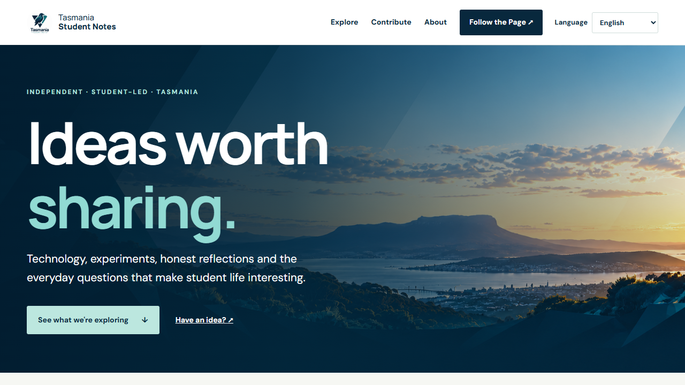
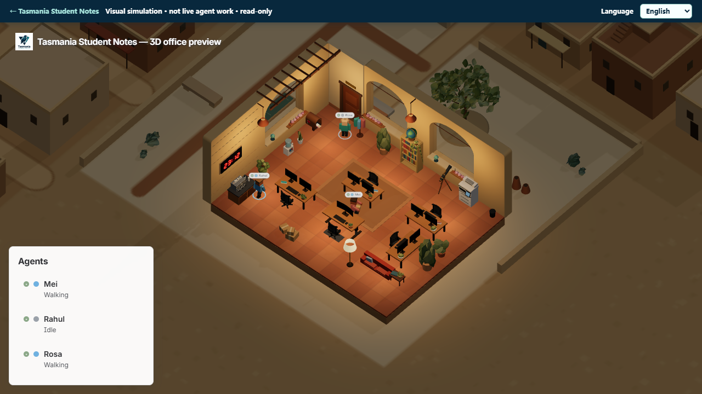
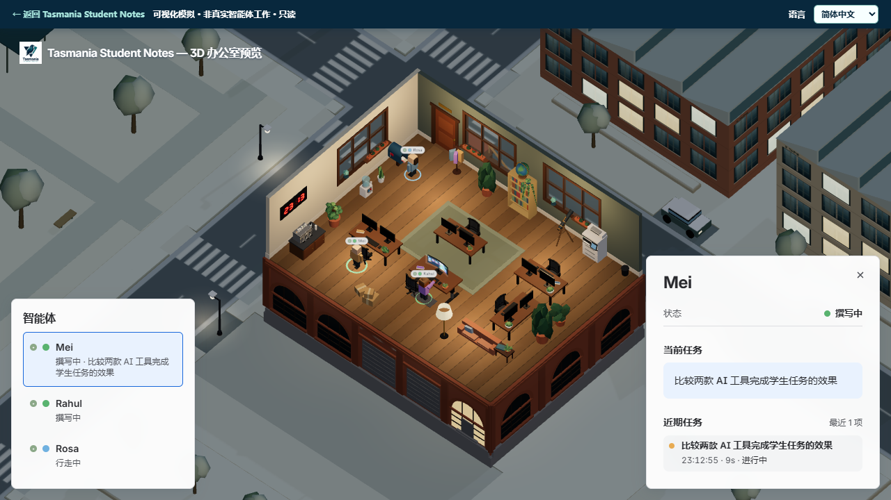
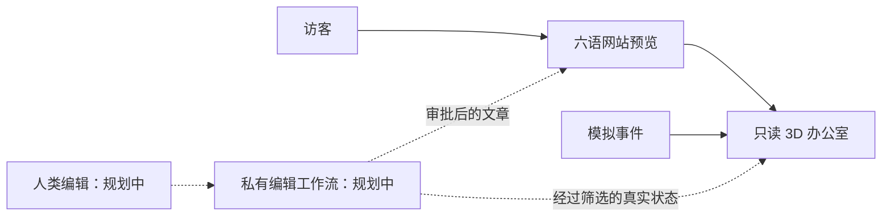

# Tasmania Student Notes｜塔斯马尼亚学生笔记

[English](README.md) · **简体中文**

这是一个面向塔斯马尼亚学生的独立、学生主导刊物。技术与 AI 是起点，学生项目、从学习走向工作、个人观点与日常生活也都在内容范围内。欢迎不同院校、不同专业的学生参与；它不是大学或学生会的官方刊物。

**[体验网站预览](https://tas-stu-notes-preview.azurewebsites.net/?lang=zh-Hans)** · **[查看 LinkedIn 主页](https://www.linkedin.com/company/144045910/)**

这个仓库是**作品集展示版**，不是完整源码仓库。这里放的是项目介绍和可公开的截图。网站目前仍是原型；3D 办公室里的智能体是**模拟演示**，并不代表真实的编辑团队正在自主运行。

## 项目现状

| | |
| --- | --- |
| 面向谁 | 塔州各院校、各专业的学生 |
| 内容起点 | 技术与 AI 的实践文章，同时容纳学生观点与反思 |
| 已上线预览 | 六语网站和只读的 3D 办公室模拟场景 |
| 私有本地试验 | 离线测试夹具，以及另一次使用虚构材料的本机四岗位 Codex SDK 试验 |
| 尚未上线 | 正式文章、投稿渠道、CMS、编辑后台、真实智能体执行 |
| 部署位置 | Azure App Service 预览站 |
| 本次记录 | 2026 年 10 月 29 日 |

## 现在可以体验什么

1. 打开[网站预览](https://tas-stu-notes-preview.azurewebsites.net/?lang=zh-Hans)。语言可在英语、简体中文、孟加拉语、尼泊尔语、韩语、越南语之间切换。
2. 点击“3D 办公室预览”。语言选择会带入办公室，返回首页时也会保留。
3. 点击角色，可查看示例状态、当前任务和近期活动。这只是只读演示：任务和行动由模拟数据生成，不是真实编辑工作的记录。

| 英文办公室 | 中文智能体详情 |
| --- | --- |
|  |  |

访客界面、示例任务、状态、工作步骤，以及 3D 场景内看板的文字会随语言切换。非英语文案目前是 AI 辅助的初版翻译；正式发布前仍需母语者审校。

## 为什么做这个项目

我们希望让有价值的学生思考被看见，而不是要求每个想法一开始就是完整文章。技术笔记可以交代测试过程和失败之处；个人文章可以讲清一个观点如何形成、改变。网站为这些不同类型的内容提供共同的展示空间。

另一个问题是运营层面的：AI 能否帮小团队研究、起草、核查和翻译，同时又不能“自己写、自己审、自己批准”？项目正在分阶段验证这件事。公开的 3D 办公室只是可视化原型，不代表真实工作流已经上线。

## 当前系统与未来方向

当前公开站点由小型 Node.js 服务、多语言静态内容和改编自 [The Roving Office](https://github.com/atlassian-labs/roving-office) 的 3D 场景组成。模拟数据与私有项目资料隔离。访客不能通过这个预览站创建办公室、指挥智能体或发表内容。

私有项目目前有两种不同的本地测试。离线测试夹具不调用模型，用来检查岗位隔离、事实冲突、预算停止和人工批准门槛；另一次四岗位 Codex SDK 试验使用虚构材料，真实调用了模型，并把筛选后的状态事件送入私有的本机办公室。这两种测试都没有驱动公开的 3D 场景。原定的五模型项目 API 试验目前已暂停。后续还需要身份与权限、来源和授权记录、编辑队列、成本限制，以及单独的公开脱敏状态流。发表必须有人批准；LinkedIn 访问与发帖仍由人手动完成。

## 已验证的内容及边界

以下是有日期的检查结果，不代表编辑服务已经投入正式运行：

| 检查 | 结果 | 能说明什么 |
| --- | --- | --- |
| 公开预览，2026 年 10 月 29 日 | 首页和办公室网址均返回 HTTP 200 | 当时预览页面可以访问；不代表智能体正在运行。 |
| 语言完整性，2026 年 10 月 29 日 | 网站 47 项内容、办公室 49 条短语在六种语言中均完整 | 必要文案齐全且与源文同步；仍需母语者审校质量。 |
| 私有智能体核心测试，2026 年 10 月 29 日 | 17 项全部通过 | 本地测试夹具覆盖事实冲突、岗位边界及停止规则；本展示仓库不公开其源码。 |
| 本机 Codex SDK 试验，2026 年 10 月 28 日 | 四个独立岗位会话；无依据文案触发 `correction_needed`；16 条筛选后的状态事件全部送达私有办公室接收端 | 这是受限的本机试验，不是公开网站后台，也不是五模型 API 测试。 |

## 我在项目中的工作

作为项目发起人，我确定了刊物定位、公开与私有的权限边界，选择优先复用开源视觉项目，并引导 AI 辅助完成网站与六语办公室预览。我检查了实际运行的网站，也明确把模拟场景与尚未上线的私有编辑流程分开。3D 渲染基础来自改编的开源项目，不是我从零独立编写的代码。

## 还没完成的部分

- 网站尚未收集学生投稿，也没有正式发布文章。
- 3D 角色是模拟的，不展示真实智能体工作。
- 编辑后台、CMS、数据库和在线多智能体执行器尚未部署。
- 翻译通过完整性检查，但还没有母语者审校。
- Azure 网址是预览站，不代表永久生产服务。

## 公开与私有的边界

此仓库**不包含应用源码**、文章草稿、学生投稿、联系人名单、提示词、API 凭据、私有智能体日志或部署配置。完整工作项目另存在私密仓库。后续公开材料会先筛选和检查。

## 第三方工作与权利

3D 办公室基于 Atlassian Labs 的 *The Roving Office*，改编了其 Apache-2.0 代码与视觉作品；原项目中单独排除授权的品牌标识已在网站改编版中替换或移除。固定版本和授权边界见 [ATTRIBUTION.md](ATTRIBUTION.md)。本仓库不授予他人复用 Tasmania Student Notes 名称、标志、截图或编辑内容的许可。
