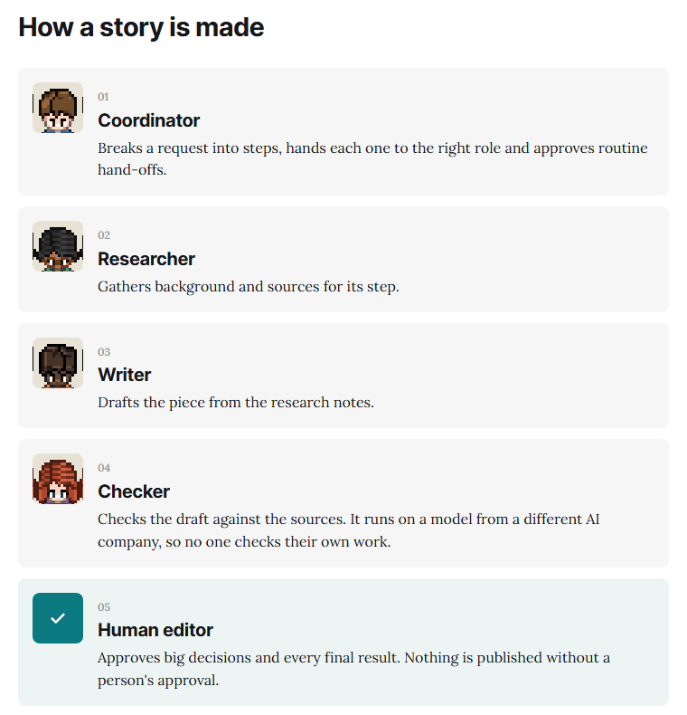
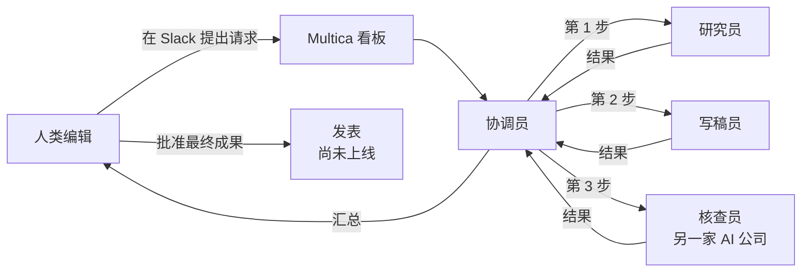

# Tasmania Student Notes｜塔斯马尼亚学生笔记

[English](README.md) · **简体中文**

> 一份独立的、学生主导的塔州刊物，网站有六种语言；背后是一个由四个 AI 角色组成的编辑部，
> 每一份最终成果都由人类编辑批准。

**[打开网站预览](https://tas-stu-notes-preview.azurewebsites.net/?lang=zh-Hans)** · **[一篇文章是怎么做出来的](https://tas-stu-notes-preview.azurewebsites.net/how-we-work/?lang=zh-Hans)** · **[看像素办公室](https://tas-stu-notes-preview.azurewebsites.net/office/?lang=zh-Hans)** · **[条款与隐私](https://tas-stu-notes-preview.azurewebsites.net/terms/?lang=zh-Hans)**

这个仓库是**精选的作品集展示版**，不是源码仓库。这里只有项目介绍、公开预览站的截图和一张海报。
网站目前是原型，还没有发表任何文章。编辑部只在编辑本人的电脑上私下运行，试运行用的都是虚构材料。

## 项目现状

| | |
| --- | --- |
| 面向谁 | 塔州的学生，不分专业、不分来自哪里 |
| 已上线 | 基于 Ghost 的 Headline 主题的六语预览网站，内嵌回放试运行录像的像素办公室 |
| 幕后 | 私有编辑部：协调员、研究员、写稿员、核查员在自托管的 Multica 看板上协作，跑在编辑电脑上的 Docker 里 |
| 谁来决定 | 协调员批准步骤之间的常规交接；人类编辑批准重大决定和每一份最终成果 |
| 尚未上线 | 正式文章、投稿通道、公开的实时工作画面、内容管理系统 |
| 托管 | Azure App Service 预览站（免费档） |
| 快照日期 | 2026 年 11 月 15 日 |

## 访客可以试什么

1. 打开[预览站](https://tas-stu-notes-preview.azurewebsites.net/?lang=zh-Hans)，在英语、简体中文、孟加拉语、尼泊尔语、韩语和越南语之间切换。默认是英文，除非你自己选了别的语言。
2. 读[一篇文章是怎么做出来的](https://tas-stu-notes-preview.azurewebsites.net/how-we-work/?lang=zh-Hans)：四个 AI 角色、人类编辑，以及谁批准什么。
3. 看[像素办公室](https://tas-stu-notes-preview.azurewebsites.net/office/?lang=zh-Hans)：它回放三段录下来的试运行，然后是一段模拟的休息时间。页面上标明是回放，从不冒充实时工作。
4. 站内搜索（放大镜或 Ctrl+K）、分享页面，或用你的语言订阅 RSS。

| 像素办公室回放 | 一篇文章是怎么做出来的 |
| --- | --- |
|  |  |

英语以外的文字由 AI 协助翻译，还需要母语者审校。每次生成网站时都会检查六种语言是否齐全。

## 一篇文章是怎么做出来的

- **一块看板。** 任务以 issue 的形式进入自托管的 Multica 看板，通常来自一条 Slack 消息。协调员把它拆成几步，一次交给一个角色。
- **角色分开。** 每个任务在自己的工作空间里运行。各角色之间不共享记忆，网页搜索和浏览工具都已关闭，也不能自行加载额外的插件或指令。
- **请别家公司来核查。** 协调员、研究员、写稿员用 Claude；核查员用 OpenAI 的 Codex，所以不会有模型核查自己写的东西。
- **分级批准。** 协调员可以批准步骤之间的常规交接；只有人类编辑能关闭整篇任务。若有角色越权关闭了任务，守卫程序会把它重新打开。
- **回放就是回放。** 私有的办公室画面实时跟随看板，只在编辑的电脑上能看。录像只保留时间、角色和动作种类，不保留标题和文字；每段录像都要人看过，才会变成公开回放。

更多细节：[编辑部如何运作](docs/how-the-newsroom-works.md)（英文）。

## 证据与局限

以下是带日期的检查结果，不代表已经有一个正式运营的编辑部：

| 检查 | 结果 | 说明了什么 |
| --- | --- | --- |
| 编辑部测试，2026-11-15 | 45 项全部通过 | 守卫、办公室信号、录像和回放导出的规则都按设计工作。代码不公开。 |
| 语言检查，2026-11-15 | 网站 121 个字段、办公室 58 条短语，六种语言齐全，覆盖 15 个页面 | 每种语言都完整、是最新的；不代表译文质量。 |
| 分级批准试运行，2026-11-13 | 约 90 秒内完成三次协调员批准；守卫没有撤回任何操作 | 在虚构材料上，各角色遵守了批准规则。这是一次短时试运行，不是持续运营。 |
| 公开预览站，2026-11-13 至 15 | 页面、订阅源和回放都正常；写入请求被拒绝；没有实时事件接口；不设置任何 Cookie | 公开站是只读的，无法显示实时工作。 |

## 我的部分

作为项目负责人，我确定了刊物的范围和公开与私有的边界；选择复用成熟的开源成果
（Ghost 的 Headline 主题、Pixel Agents 美术、The Roving Office 模拟程序、Multica 看板），
而不是从零开发；并规定了谁能批准什么。我指挥 AI 协助完成了网站、编辑部环境、守卫程序和回放流程，
并在实际运行的系统里逐步检查。

## 还没完成的

- 还没有发表文章，也还没开放投稿。
- 编辑部只在虚构材料上做过短时试运行。
- 守卫程序是事后纠正，不能事先阻止操作。
- 四个角色目前共用一个上锁的容器；每个角色单独一个容器还在计划中。
- 译文和条款页还需要母语者和律师审阅。
- Azure 地址是预览站，不是长期服务。

## 公开与私有

本仓库**不包含源码**、草稿、学生投稿、联系人名单、提示词、密钥、智能体日志或部署配置。
完整项目保存在另一个私有仓库里，本仓库与它不共享提交历史。
[发布边界](docs/publication-boundary.md)（英文）写明了这里能放什么，以及每次更新怎么检查。

## 海报

快照日期 2026 年 11 月 15 日，画面来自公开预览站。

## 第三方作品与权利

网站复用了保留各自许可的开源作品：Ghost 的 Headline 主题（MIT）、Pixel Agents 美术（MIT）、
The Roving Office 模拟程序（Apache-2.0），以及 Inter 和 Lora 字体（SIL 开放字体许可）。
详见 [THIRD_PARTY_NOTICES.md](THIRD_PARTY_NOTICES.md) 和 `third_party/` 目录。

Copyright (c) 2026 Tasmania Student Notes，保留所有权利。见 [LICENSE](LICENSE) 和网站的
[条款页](https://tas-stu-notes-preview.azurewebsites.net/terms/?lang=zh-Hans)。
法律允许的使用、GitHub 平台本身的浏览与 fork 权限，以及上述第三方许可仍然适用。
