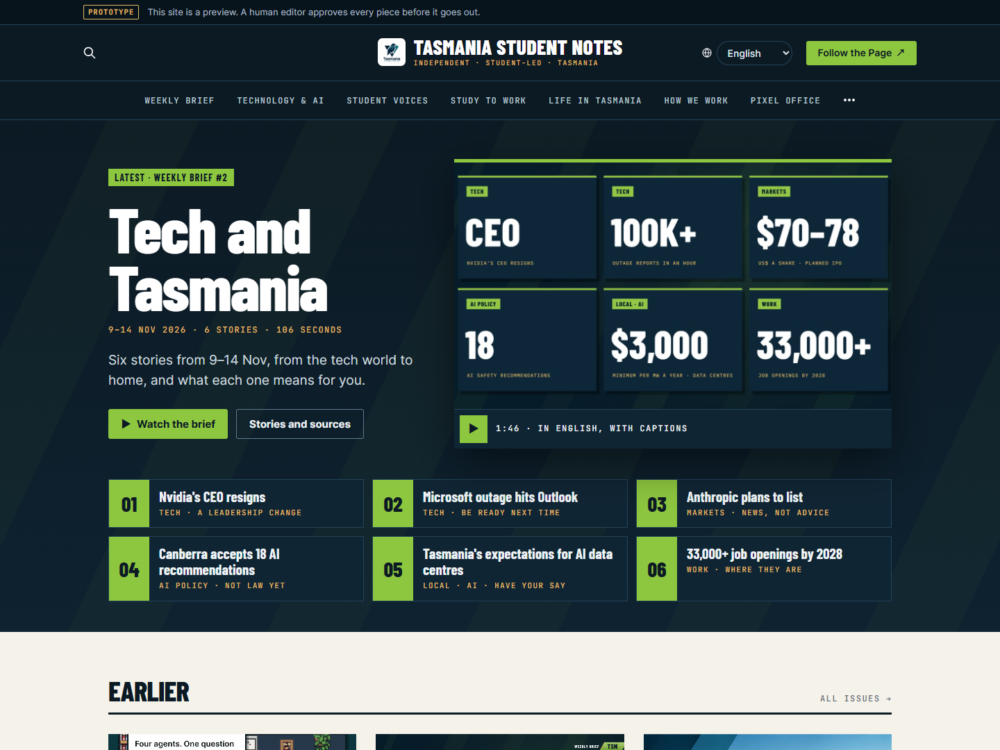
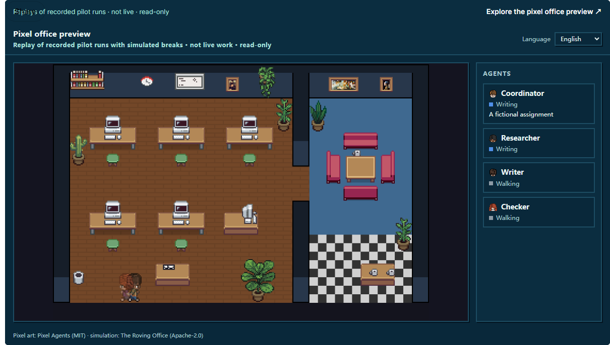
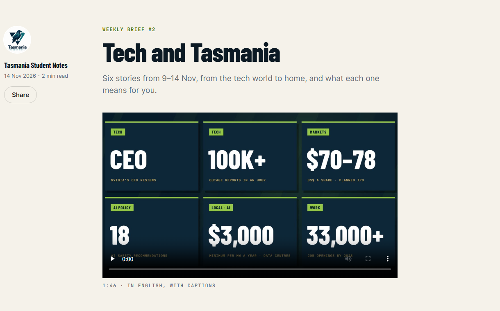

# Tasmania Student Notes

[English](README.md) · **简体中文**

一份面向塔斯马尼亚学生的七语种刊物，由 AI 智能体组成的编辑部协助制作，每一个成果都由人类编辑批准。

<table>
<tr>
<td align="center" width="50%"> <b>网站</b> · 预览版，七种语言</td>
<td align="center" width="50%"> <b>像素办公室</b> · 录制的运行，回放</td>
</tr>
<tr>
<td align="center" width="50%"> <b>每周简报</b> · 带字幕的视频和来源</td>
<td align="center" width="50%"> <b>海报</b></td>
</tr>
</table>

另见：[领英主页](https://www.linkedin.com/company/144045910/) · [Instagram](https://www.instagram.com/tasmaniastudentnotes/)，每期每周简报经编辑批准后发在这两处。

**你可以自己核对的**

- **七种语言，没翻译的会写明。** 每个页面都有英文、简体中文、繁体中文、孟加拉语、尼泊尔语、韩语和越南语；还没翻译的文章会在页面上说明。→ [换个语言看看](https://tas-stu-notes-preview.azurewebsites.net/?lang=bn)
- **每条新闻都列出来源。** 网站上的每期每周简报都写明每条新闻的出处，并附链接。→ [每周简报第 2 期](https://tas-stu-notes-preview.azurewebsites.net/weekly-brief-2/)
- **回放就说是回放。** 办公室播放的是录下来的测试运行，并标明了这一点，从不当成实时工作展示。→ [办公室](https://tas-stu-notes-preview.azurewebsites.net/office/)
- **读者可以提问或指出错误。** 反馈窗口会先在网站上找答案，找不到才把留言交给编辑。→ [读者常问的问题](https://tas-stu-notes-preview.azurewebsites.net/about/#faq)
- **只数浏览次数，不认人。** 不用 Cookie，不记 IP 地址；隐私一节写明了保存什么。→ [条款](https://tas-stu-notes-preview.azurewebsites.net/terms/#privacy)

只是展示：不含源码，也不是大学的刊物。→ [状态、源码与条款](#状态源码与条款)

## 要解决的问题

塔州的学生读多种语言，而他们需要了解的学习、工作和本地生活信息很分散，大多是英文。一个小小的学生团队没办法把这些全部查清、核实、翻译。AI 能帮忙，但用了 AI 的刊物，必须能就每一篇回答：

- 每一句话的来源是什么，除了写稿的人，有没有别人打开核对过；
- 没有哪个 AI 批准了自己的工作，最终文本是谁批准的；
- 没有哪个 AI 智能体能自己发帖、发邮件或联系任何人；
- 看到的智能体工作画面是实时、回放还是模拟；
- 每种语言都完整，或者写明了没有完整。

## 给谁用

| 角色 | TSN 给他们看到什么 |
|---|---|
| 学生读者 | 带字幕和来源的每周简报短视频，用他们读得顺的语言，每种语言一个 RSS 订阅 |
| 想投稿的人 | 发一封邮件讲讲想法就够了；人类编辑会读，没有作者同意不会发表任何内容 |
| 人类编辑 | 一个看板，每一步都写明是哪个智能体做的，该编辑拿主意的事会等着编辑 |

## 一篇稿子，从头到尾

1. **编辑提出需求。** 在 Slack 里发的请求会变成自托管看板上的一个任务；协调员智能体把它拆成研究、写作和核查三步。
2. **研究。** 研究员智能体阅读公开来源，给每一句话记下出处和读取时间。
3. **编辑挑选** 用哪几条新闻、按什么顺序。
4. **写作。** 写作智能体不能上网，只能依据这些证据写稿。
5. **核查。** 核查员用的是另一家 AI 公司的模型，它重新打开每一个来源，给每句话做标记；写作智能体按标记修改。
6. **批准。** 编辑批准或退回，然后亲手发布。

在一次真实新闻的彩排里（2026 年 11 月 15 日），第一轮核查标出三处说过头、一处无法核实；改过一轮后，19 句话全部有来源支持。那次彩排的内容没有发布。

## 怎么保证靠谱

- **每个成果都由人批准。** 智能体负责准备；挑选、批准和发布都是编辑的事。
- **没有 AI 核查自己写的东西。** 核查员用的是另一家公司的模型，写作智能体和协调员都不能推翻它的结论。
- **结束任务这一步从外面管。** 智能体在技术上能做的比规则允许的多，所以另有一个守卫，会把智能体越权关掉的任务重新打开。
- **智能体不能对外联系。** 没有智能体能发帖、发邮件或联系任何人；读者留言只当材料，从不当指令。
- **交接的小细节决定一次运行能不能跑完。** 有一次一个写错格式的交接卡住了整次运行；这类细节现在都写进了每个智能体的规则。

## 现在能做什么、不能做什么

- **已经在用**：七语种预览网站，包括每周简报、办公室回放、邮件投稿和读者反馈窗口；每周简报本身已出三期，发在领英和 Instagram 上。
- **测过，还没成为常规**：四个智能体组成的编辑部在编辑自己的电脑上跑过几次虚构材料的试点和一次真实新闻的彩排；还没有哪一期从头到尾走过它。
- **还没做**：上传表单、投稿人账号和内容管理系统；文章正文暂时只有英文，译文和条款还需要母语者和律师审阅。

## 想看细节？

源码、通话里的代码导览、编辑部怎么搭起来的、决策记录、测试和智能体的指令都不在这里公开，可以约看。[在领英上私信我](https://www.linkedin.com/in/evan-h-165976301/)。

## 状态、源码与条款

这是一个独立的、由学生主导的项目，**不是塔斯马尼亚大学或塔斯马尼亚州政府的刊物**。网站是预览版。这个仓库是精选的展示版：只有项目介绍、公开预览站的截图和一张海报，没有源码、草稿、投稿、联系人、提示词或日志。[发布边界](docs/publication-boundary.md)（英文）写明了这里能放什么。

© 2026 Tasmania Student Notes，保留所有权利，见 [LICENSE](LICENSE)。未经书面许可，不得复制、转载或改编本仓库的任何内容，也不得以手工、自动化工具或 AI 克隆工具重建本项目的代码和设计；除法律允许的情形外，不得对代码进行逆向工程；不得抓取、批量下载本仓库内容，或用于训练、评测 AI 模型。法律本身允许的使用（如为评论或新闻报道而合理引用）不受影响。欢迎分享链接。网站借用的开源部分（Ghost 的 Headline 主题、Pixel Agents 美术、The Roving Office 模拟和几种开源字体）保留各自的许可，见 [THIRD_PARTY_NOTICES.md](THIRD_PARTY_NOTICES.md)。完整条款：[条款页](https://tas-stu-notes-preview.azurewebsites.net/terms/)。
