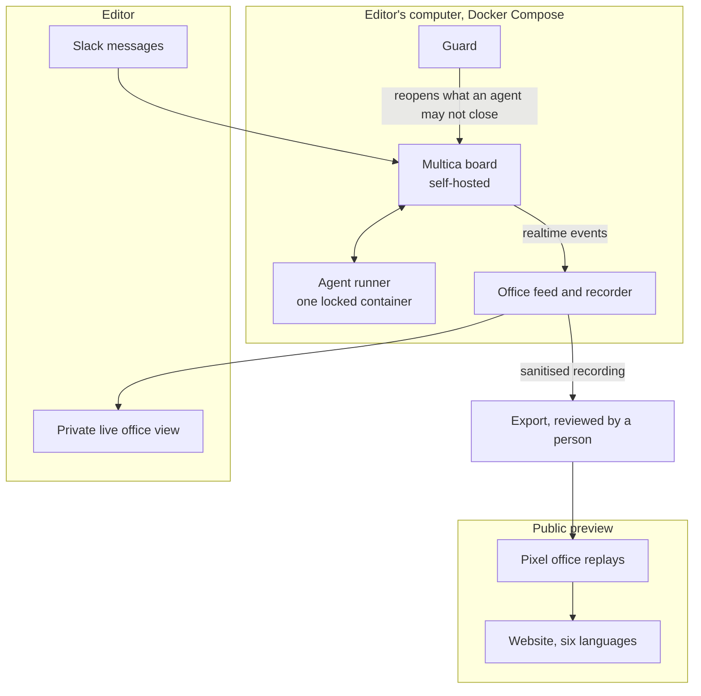

# How the newsroom works

Snapshot: 15 November 2026. This describes a private pilot that runs on the
editor's own computer. It has handled fictional material and one rehearsal on
real public news (15 November 2026); no story has been published through it.

## The pieces

- **Multica** (self-hosted, open source) is the board. The editor or a Slack
  message creates an issue; the board assigns it to a role and starts a run.
- **The agent runner** is one locked container that runs the four roles:
  - Coordinator, Researcher and Writer on Claude (Claude Code);
  - Checker on OpenAI Codex, so the facts are checked by a different company's model.
- **The guard** watches the board. No agent may close the main issue, and only
  the Coordinator may close a sub-step. Anything else an agent closes is
  reopened with a comment.
- **The office feed** turns board events into movements in a pixel office
  (picking up a letter, reading at the shelf, typing, delivering). The live
  view is served only on the editor's computer.
- **The recorder** keeps the time, the role and the kind of movement. It drops
  titles, labels and text. An export step cuts a session into a short replay,
  and a person reviews it before it is added to the public site.

## Who decides what

| Decision | Who |
| --- | --- |
| Splitting a request into steps and assigning them | Coordinator |
| Approving the routine hand-off from one step to the next | Coordinator |
| Judging whether claims hold up against sources | Checker |
| Picking the stories for a news brief | Human editor |
| Big decisions, anything unclear, and every final result | Human editor |
| Publishing, outside contact, corrections | Human editor only |

No role may approve its own work. Agents are not allowed to contact anyone
outside the project, and nothing is published automatically.

## How the roles are kept apart

- Each task runs in its own working directory and session; agents do not share
  memory between tasks or with each other.
- Managed settings switch off saved memory, user-level instructions and extra
  plug-ins for every role.
- Only the Researcher and the Checker can search and read public web pages, and
  LinkedIn is blocked for both. The Coordinator and the Writer have no web
  tools, so the Writer works only from the Researcher's evidence.
- Each role is a separate agent on the board, so every action is attributed to it.

## Limits

- The guard corrects after the fact; it cannot stop an action in advance.
- All four roles still share one container. Separate containers per role are
  planned.
- Runs so far are short pilots on fictional material, plus one rehearsal on
  real news that was not published.
- Web access is not yet limited to a list of approved sites.
- The public website does not connect to the newsroom. It only receives replay
  files that a person has exported and checked.
